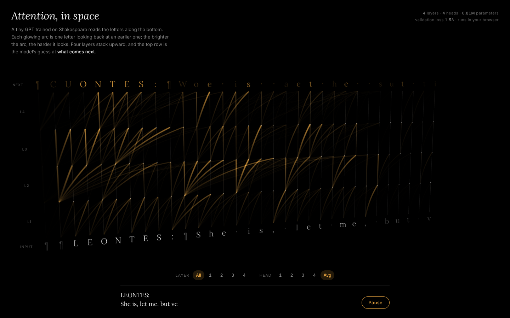

# Attention, in space



A tiny character-level GPT, trained from scratch on Shakespeare, running entirely in the browser. Type, and watch its attention in 3D.

The letters you type sit along the bottom. Four layers stack upward. Inside each layer, a glowing arc runs from an earlier letter (one layer down) to a later letter (one layer up): the path information takes through the network. An arc's thickness and brightness show how much attention that letter pays. The top row shows the model's best guess at the next character after each position, brighter when it is more confident. Hover over a column, or tap it on a phone, to see that position's top-5 next characters.

It follows [micrograd 3D](https://github.com/joezgao/micrograd-3d): micrograd shows one tiny network learning; this shows a whole transformer reading.

## Open it

Open `attention.html` in a recent browser. It is a single 1.17 MB file with the model weights inlined; it needs an internet connection to load three.js and two fonts. If your browser blocks local files:

```bash
python3 -m http.server 8000   # then open http://localhost:8000/attention.html
```

- **Layer** (All, 1–4) and **Head** (1–4, Avg) pick which attention to draw.
- Drag to orbit, scroll or pinch to zoom, double-click to reset.
- **Write** lets the model write (temperature 0.8). On arrival it writes for about 9 seconds, then waits for you.
- Narrow screens (under 720 px) show 16 letters instead of 32. `prefers-reduced-motion` turns off camera drift, scroll animation, easing and autoplay.

Try **Layer 2, Head 3**: it looks back about 13 characters on average and mostly attends to the last space or line break, a word-boundary head.

## The model

| | |
|---|---|
| Architecture | nanoGPT design: learned token and position embeddings, 4 pre-LayerNorm blocks (causal self-attention plus a 4× MLP with tanh-GELU), a final LayerNorm, and an `lm_head` tied to the token embedding |
| Size | 4 layers, 4 heads, d_model 128, context 64 characters, vocab 65, **809,856 parameters** |
| Data | tiny-shakespeare (1,115,394 characters, from `karpathy/char-rnn`), split 90/10 into train and validation |
| Validation loss | **1.527** at the best checkpoint (step 6000, fp32). The shipped int8 weights score **1.531** on a larger fixed sample of validation windows; the page shows that number. |
| Shipped weights | int8 with one fp32 scale per row (845 kB), base64-inlined. Quantising changed the loss by +0.0003. |

**Training.** The model was written in pure NumPy with a hand-derived backward pass, following nanoGPT's `model.py` op for op (backward written layer by layer in the style of llm.c), and every parameter group was checked against finite differences. The recipe is nanoGPT's `train_shakespeare_char`, scaled down: AdamW (β 0.9, 0.99; weight decay 0.1 on matrices), lr 2e-3 with a 200-step warmup and cosine decay to 2e-4, gradient clipping at 1.0, batch 32 × 64 tokens, no dropout, 7,000 steps. It took 32 minutes on 2 CPU cores; validation loss was best at step 6000 and had started to overfit slightly by 7000 (1.530).

A sample at temperature 0.8, after the prompt *"ROMEO: But soft, what light through yonder window breaks? JULIET:"*:

> O Capulet, Aufidius,
> And it is here loved so the state bird,
> And set for yourself must this arty would show,
> That which between her so his fingers
> Upon him. But now heavens by this day,

## How the page works

- One HTML file. three.js 0.147.0 loads from jsDelivr; Lora and Inter load from Google Fonts. Everything else, weights included, is inline.
- The forward pass is plain JavaScript in an inline Web Worker, so the 3D view never waits for the model. Each new character re-runs the last 64 characters and returns every layer's attention matrices and the next-character probabilities.
- The arcs are one static ribbon mesh, one ribbon per (layer, query, key) pair, with widths computed in screen space in the vertex shader. Attention weights reach the GPU as a small float texture each frame and ease toward their new values.

## Limits

- 60 fps was not measured on real hardware. It was checked only with software WebGL (21–23 fps at 1440 px while writing); the per-frame JavaScript is small and the arc mesh is about 93k triangles, so a laptop GPU should manage 60.
- It is a 0.8M-parameter model with 64 characters of context: mostly right spelling and the right form (speaker names, line breaks), but the meaning is nonsense.
- Only attention within the visible window is drawn; attention to characters that have scrolled out of view is not shown.
- Characters outside the training vocabulary (most digits, for example) are dropped from what you type.

## In this repository

- `attention.html`: the piece
- `screenshots/`: typing, generating, an orbited view of layer 2 head 3, and a phone view

The NumPy training, gradient-check and export scripts are not in this repository yet.

## Credits and license

Model design after [nanoGPT](https://github.com/karpathy/nanoGPT) (MIT); training text: tiny-shakespeare from [char-rnn](https://github.com/karpathy/char-rnn) (Shakespeare, public domain). three.js is MIT; the fonts are under the SIL Open Font License.

Code: MIT. See [LICENSE](LICENSE).

Built with Claude.
